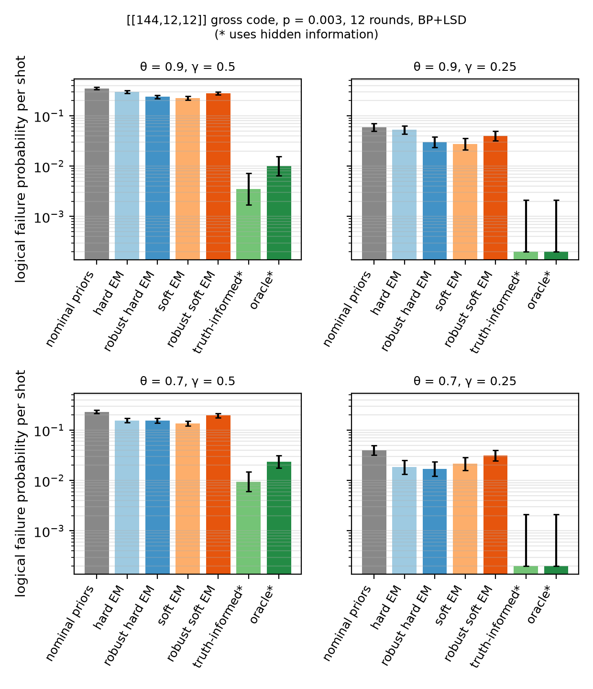

# Locating correlated noise bursts from the syndrome alone: a pilot study on the gross code

**P. Benedict**
Independent researcher — benedictpatrickjohn@gmail.com

15 November 2026 — preprint, not peer reviewed (revised: neural estimator evaluated at four correlation settings; misspecification and no-coupling ablation added)

## Abstract

Dangi and Chatterjee recently showed that spatially correlated noise degrades belief-propagation-based decoders of quantum LDPC codes by orders of magnitude, and that an oracle decoder given the hidden noise field recovers most of the loss; whether the field can be estimated from the syndrome alone was left open. We study that question on the [[144,12,12]] bivariate bicycle (gross) code with an independent implementation of the circuits and noise model. At physical error rate p = 0.003 and correlation strength θ = 0.9, the mismatched BP+LSD decoder fails on 35% of 12-round memory shots while the oracle fails on 1%. We test two families of syndrome-only estimators. (i) Model-based: exact hidden-Markov inference of the field from a first decoding pass, iterated. (ii) Learned: a neural network that maps the syndrome directly to a per-site posterior over the field, followed by one model-based refinement pass. The best model-based estimator closes 37–58% of the gap between the mismatched decoder and the oracle across four correlation settings (2,000 shots each). The neural estimator with refinement is the best method under strong correlation (θ = 0.9), closing 48% and 59% of the gap and significantly outperforming the best model-based estimator on the same shots (exact McNemar p = 2.5 × 10⁻⁸ and p = 0.018). Under weaker correlation (θ = 0.7) it closes 44% and 37% and is statistically indistinguishable from the model-based estimators, and the network without refinement is significantly worse than them. An ablation that removes the field's spatial coupling from the estimator separates two sources of gain: under strong correlation the coupling accounts for most of the improvement (about 35% of the gap closed with it against 10% without, p < 10⁻²⁹), and estimators given wrong correlation parameters retain 22–30%; under weak, short-range correlation and on uncorrelated noise much of the gain of one estimator is a generic re-decoding effect unrelated to field estimation. A seemingly natural "ceiling" experiment is shown to leak the answer. The hidden field is therefore partly, but so far not mostly, recoverable from the syndrome. All code and per-shot data are released.

## 1. Introduction

Quantum LDPC codes such as the bivariate bicycle codes of Bravyi et al. [1] promise large savings in qubit overhead, and a series of fast decoders has been developed for them, including BP+OSD [2], BP+LSD [3], Relay-BP [4], beam search [5] and PriorTilt [6]. These decoders are tuned and benchmarked under independent noise, where every fault mechanism fires independently with a known prior probability.

Dangi and Chatterjee [7] examined what happens when that assumption fails. Under a noise model in which a hidden, spatially correlated Gaussian field modulates every fault probability while leaving its marginal unchanged, they report logical error rates that rise by roughly two orders of magnitude for Relay-BP, beam search and BP+OSD. They also show that handing the decoder priors conditioned on the realised field removes most of the damage, and conclude that prior mismatch is a major cause. They state explicitly that they do not claim the field can be estimated from the syndrome alone, and that designing an estimator is outside their scope.

This note is a first attempt at that estimator. Our contributions are:

1. An independent reproduction of the degradation and of the oracle recovery, with our own circuit generator and sampler (Section 3.1).
2. A model-based estimator: exact forward–backward inference of the field on a hidden Markov chain, driven by a first decoding pass, with a noisy-observation variant (Section 2.3).
3. A learned estimator: a neural network trained on simulated shots to predict the field from the syndrome (Section 2.4).
4. Two cautionary findings from a control experiment, which limit what can be claimed (Section 3.3).

We report partial success and are explicit about the limits (Section 4).

## 2. Methods

### 2.1 Code, circuit and decoder

We use the [[144,12,12]] gross code [1] with the depth-7 CNOT syndrome-extraction schedule of Ref. [1], implemented from scratch in Stim [8]. The experiment is a Z-basis memory with 12 syndrome rounds, noiseless data initialisation and final readout, under circuit-level depolarizing noise of strength p = 0.003. Decoding uses Z-type detectors only. The detector error model has 936 detectors and 8,784 distinct fault mechanisms, matching the size reported in Ref. [4] for this decoding problem. A shot fails if any of the 12 logical observables is predicted wrongly. All decoding uses BP+LSD (min-sum, 30 iterations, order 0) from the `ldpc` package [3]; methods differ only in the priors given to it.

### 2.2 Correlated noise model

We follow Ref. [7]. For each round t an independent stationary Gaussian AR(1) chain J(t,k) runs over the qubit index k, with correlation ρ = exp(−1/L) and L = n^γ, where n = 288 is the number of qubits in the circuit. Each fault mechanism j is assigned a representative round and qubit, and fires independently given J with probability

g_j(J) = Φ( (Φ⁻¹(p_j) + θ J(t_j, q_j)) / √(1 − θ²) ),

which preserves the marginal E[g_j] = p_j for every θ. We sample faults directly at the level of the detector error model. At θ = 0.9 the model is extremely bursty: a fault with p_j = 0.002 has conditional probability about 10⁻¹¹ at J = 0 and about 0.34 at J = 3, so nearly all faults occur inside rare high-field regions. The mean number of faults per shot is unchanged (35.2–35.4 in all settings, against 35.4 for independent noise).

### 2.3 Model-based estimators

Given a per-mechanism estimate m_j ∈ [0, 1] of which faults fired, each round is a hidden Markov chain over the qubit index with Bernoulli emissions g_j(J_k). We discretise J on 41 levels in [−4, 4] and run forward–backward to obtain the posterior over J at every site, and from it the posterior-mean prior q_j = E[g_j(J) | m]. The decoder is then rerun with priors q. We compare:

- **hard EM**: m is the hard output of the previous decode; 3 passes.
- **robust hard EM**: as above, but the decode is treated as a noisy observation of the true faults, with false-positive rate ε = 0.03 and miss rate δ = 0.3, so that isolated mis-attributed faults do not force a spurious field spike; 3 passes.
- **soft EM**: m is the min-sum BP posterior marginal under the current priors; 6 passes.
- **robust soft EM**: soft marginals with the noisy-observation model; 6 passes.

The estimator is given the true θ and γ. The values of ε and δ were chosen on a separate 280-shot pilot with different seeds.

### 2.4 Neural estimator

A fully connected network (936 inputs, three hidden layers of width 3,072 with GELU activations) outputs, for each of the 3,456 sites (12 rounds × 288 qubits), a categorical distribution over seven field bins with edges at J = 1, 1.5, 2, 2.5, 3, 3.5. It is trained with class-weighted cross-entropy on freshly simulated shots (syndrome, true field), generated on the GPU, for 20 minutes on a laptop GPU (5,423 steps of 256 shots, 1.39 million shots, AdamW, learning rate 3 × 10⁻⁴). Priors are obtained as q_j = Σ_k P(bin k at site of j) · E[g_j | bin k]. We report the network alone (**nn**) and followed by one robust hard-EM pass (**nn + refine**). A separate network is trained for each correlation setting and evaluated at that setting, on seeds disjoint from training. The networks for the three other settings were trained for 12 minutes each (4,966 to 6,051 steps, 1.27 to 1.55 million shots).

### 2.5 Reference points

- **nominal**: priors p_j (the mismatched decoder).
- **oracle**: priors g_j(J) for the realised field. This uses hidden information and is a bound, not a decoder.

We define the fraction of the oracle gap closed by a method as (F_nominal − F_method) / (F_nominal − F_oracle), with F the number of failures on the same shots.

## 3. Results

### 3.1 Reproduction and model-based estimators

Table 1 gives failures in 2,000 shots per setting; all methods decode identical shots. Figure 1 shows the same data with 95% Wilson intervals.

**Table 1.** Failures per 2,000 shots, gross code, p = 0.003. "Gap closed" refers to the best syndrome-only method in the row (bold).

| θ | γ | nominal | hard EM | robust hard EM | soft EM | robust soft EM | oracle | gap closed |
|---|---|---|---|---|---|---|---|---|
| 0.9 | 0.5 | 701 | 595 | 476 | **448** | 558 | 20 | 37% |
| 0.9 | 0.25 | 119 | 105 | 60 | **55** | 80 | 0 | 54% |
| 0.7 | 0.5 | 462 | 312 | 310 | **269** | 389 | 47 | 47% |
| 0.7 | 0.25 | 80 | 37 | **34** | 43 | 63 | 0 | 58% |

The degradation and the oracle recovery reported in Ref. [7] reproduce: at θ = 0.9, γ = 0.5 the mismatched decoder fails on 35.1% of shots (95% interval 33.0–37.2%) and the oracle on 1.0% (0.6–1.5%). Syndrome-only estimation recovers between 37% and 58% of the gap. Soft EM is best in three settings and robust hard EM in one. Combining the two (robust soft EM) is worse than either in every setting.

The methods differ in how they fail. Robust hard EM almost never turns a correct nominal decode into a failure (8, 0, 9 and 2 such shots in the four settings), whereas soft EM breaks 18–32 shots per setting while fixing more.

**Figure 1.** Logical failure probability per 12-round shot with 95% Wilson intervals. Starred methods use hidden information; "truth-informed" is the leaky quantity discussed in Section 3.3 and is not a valid bound. Bars with zero observed failures are drawn at the plot floor.

### 3.2 Neural estimator

Table 2 compares the network with the model-based estimators on 2,000 fresh shots at θ = 0.9, γ = 0.5, and Table 3 extends the comparison to the other three settings.

**Table 2.** Failures per 2,000 shots, θ = 0.9, γ = 0.5 (evaluation seeds disjoint from Table 1 and from training).

| Method | Failures | Gap closed |
|---|---|---|
| nominal | 679 | 0% |
| robust hard EM | 459 | 33% |
| soft EM | 451 | 35% |
| nn | 430 | 38% |
| **nn + refine** | **361** | **48%** |
| oracle | 20 | 100% |

The network alone is not significantly better than soft EM (140 shots where only the network succeeds against 119 where only soft EM does; exact McNemar p = 0.21). The network followed by one refinement pass is significantly better than soft EM (175 against 85; p = 2.5 × 10⁻⁸) and than robust hard EM (180 against 82; p = 1.3 × 10⁻⁹). At the end of training the network recovered 46% of sites with J > 2 at 26% precision, against a base rate of 2.3%, and was still improving slowly. Network inference took 3.2 s for all 2,000 shots including sampling.

**Table 3.** Failures per 2,000 shots at the other three settings, each with its own network (evaluation seeds disjoint from training). The last column is the exact McNemar p-value for nn + refine against soft EM on the same shots.

| θ | γ | nominal | robust hard EM | soft EM | nn | nn + refine | oracle | gap closed by nn + refine | p |
|---|---|---|---|---|---|---|---|---|---|
| 0.9 | 0.25 | 118 | 75 | 67 | 68 | **48** | 0 | 59% | 0.018 |
| 0.7 | 0.5 | 455 | 284 | **259** | 356 | 271 | 36 | 44% | 0.42 |
| 0.7 | 0.25 | 91 | 52 | **51** | 88 | 57 | 0 | 37% | 0.48 |

The advantage of the learned estimator depends on the correlation strength. At θ = 0.9 the network with refinement is the best method at both correlation lengths. At θ = 0.7 it is not: with refinement it is statistically indistinguishable from soft EM and robust hard EM, and the network alone is significantly worse than soft EM (p = 4.2 × 10⁻¹¹ at γ = 0.5 and p = 6.5 × 10⁻⁶ at γ = 0.25), closing only 24% and 3% of the gap. At θ = 0.7 the conditional fault probability varies less sharply with the field, so bursts are less distinct from ordinary noise; whether a longer-trained or structured network would recover an advantage there is untested. These three networks were trained for 12 minutes against 20 for the network of Table 2.

### 3.3 Control on uncorrelated noise

We ran the model-based estimators, configured for θ = 0.9 and γ = 0.5, on shots drawn with θ = 0 (independent noise). Failures per 2,000 shots: nominal 27, hard EM 17, robust hard EM 7, soft EM 24, robust soft EM 24. Two observations follow.

**Part of the gain is not field estimation.** Robust hard EM reduces failures from 27 to 7 on noise that contains no field at all, fixing 20 shots and breaking none. Re-decoding with priors sharpened around a first solution evidently helps BP+LSD in its own right, in the spirit of prior-perturbation decoders [6]. The improvements in Table 1 are therefore a mixture of field estimation and this generic effect, and we have not separated the two.

**A "truth-informed" ceiling leaks the answer.** A tempting upper bound on the estimator is to run the HMM on the true fault pattern instead of a decoded one. Under correlated noise this gave results at or below the oracle (7 against 20 failures at θ = 0.9, γ = 0.5; 19 against 47 at θ = 0.7, γ = 0.5). On the control it gave 0 failures where the oracle, which equals the nominal decoder at θ = 0, gave 27. Conditioning on the true faults raises the priors exactly at the fault locations and so tells the decoder the solution. This quantity is not a valid ceiling for field estimation and should not be read as evidence that the field is recoverable.

### 3.4 Misspecified parameters and a no-coupling ablation

Section 3.3 leaves open how much of the model-based gain comes from locating bursts. We therefore decoded fresh shots (seeds disjoint from all other tables) with robust hard EM and soft EM in three configurations: **matched**, given the true (θ, γ); **wrong**, given the parameters of a different setting; and **no coupling**, given the true θ but with the field's spatial correlation removed (ρ = 0), so that each site is inferred from its own evidence only. The no-coupling estimator can still sharpen priors around a first solution, but it cannot use a fault at one site as evidence about its neighbours.

**Table 4.** Failures per 2,000 shots. For data at θ = 0.9, γ = 0.5 the wrong model is (0.7, 0.25); for data at θ = 0.7, γ = 0.25 it is (0.9, 0.5). For uncorrelated data (θ = 0) "matched" denotes the (0.9, 0.5) model and "wrong" the (0.7, 0.25) model; the no-coupling model uses θ = 0.9.

| Data (θ, γ) | Nominal | Oracle | Robust matched | Robust wrong | Robust no coupling | Soft matched | Soft wrong | Soft no coupling |
|---|---|---|---|---|---|---|---|---|
| 0.9, 0.5 | 694 | 24 | 474 | 548 | 630 | 458 | 494 | 624 |
| 0.7, 0.25 | 80 | 0 | 33 | 27 | 42 | 43 | 53 | 68 |
| 0, – | 27 | 27 | 7 | 9 | 8 | 24 | 22 | 25 |

**Strong correlation: the spatial coupling carries most of the gain.** At θ = 0.9, γ = 0.5 the matched estimators close 33% (robust) and 35% (soft) of the gap, and the no-coupling versions close 10% each. The difference is highly significant on the same shots (exact McNemar p = 3.1 × 10⁻³³ for robust, p = 4.2 × 10⁻³⁰ for soft). Roughly two thirds of the gain at this setting therefore requires the field's spatial structure, which is direct evidence of burst localisation rather than generic re-decoding.

**Wrong parameters cost some, not all, of the gain.** With the wrong model the estimators close 22% (robust) and 30% (soft) of the gap at θ = 0.9, γ = 0.5: significantly worse than matched (p = 2.6 × 10⁻¹⁰ and p = 1.3 × 10⁻³) and significantly better than no coupling (p = 6.1 × 10⁻¹⁴ and p = 1.3 × 10⁻²¹). At θ = 0.7, γ = 0.25 matched and wrong are not distinguishable (p = 0.33 robust, p = 0.11 soft).

**Weak, short-range correlation: the evidence for localisation is weaker.** At θ = 0.7, γ = 0.25 the robust estimator without coupling still removes 38 of 80 failures (matched: 47), and the matched-versus-no-coupling difference is marginal (p = 0.049). For soft EM the coupling matters clearly (43 against 68 failures, p = 4.7 × 10⁻⁴), and soft EM without coupling is not significantly better than the nominal decoder (p = 0.18).

**The generic effect belongs to robust hard EM.** On uncorrelated data robust hard EM cuts failures from 27 to 7–9 whichever model it is given, including no coupling (p < 10⁻⁵ against nominal in each case), reproducing Section 3.3. Soft EM stays at 22–25, indistinguishable from nominal (p ≥ 0.75). Soft EM is therefore the cleaner probe of field estimation: its gains appear only when the data are correlated and shrink sharply when the coupling is removed.

## 4. Limitations

- **Hyperparameters.** The networks are trained and tested at a single matched setting each. The model-based estimators were tested with one wrong parameter pair per setting (Section 3.4); estimating θ and γ from data is untested.
- **One code, one basis, one decoder.** Results are for the gross code, Z-basis memory, and BP+LSD at order 0. Stronger decoders such as Relay-BP [4] may leave a different gap.
- **One noise level.** p = 0.003 only, where failure rates are high enough to measure with 2,000 shots.
- **Synthetic correlation.** The AR(1) field over the circuit's qubit index follows Ref. [7] and is not a hardware model. Rounds are independent.
- **Small network, short training.** A generic fully connected network trained for 12 to 20 minutes per setting, with unequal training time across settings; no architecture search, no use of the code's symmetry.
- **Confounded gains.** The model-based gains include an effect unrelated to field estimation (Sections 3.3 and 3.4). The ablation separates the two for the model-based estimators at two settings only, and no equivalent control exists yet for the neural estimator.
- **Pilot-scale statistics.** 2,000 shots per point; zero-failure entries bound the rate only below about 0.2%.

## 5. Conclusion

On the gross code under the correlated noise model of Ref. [7], a hidden noise field can be partly recovered from the syndrome alone: iterated hidden-Markov inference closes roughly a third to a half of the gap to an oracle decoder, and a small neural burst locator with one refinement pass does better under strong correlation (48% and 59% at θ = 0.9) but not under weaker correlation (θ = 0.7), where it matches the model-based estimators at best. An ablation shows that under strong correlation about two thirds of the model-based gain depends on the field's spatial coupling, and that the estimators tolerate wrong correlation parameters at a moderate cost; under weak, short-range correlation a generic re-decoding effect accounts for much of the gain of robust hard EM. A large gap to the oracle remains. The diagnosed obstacle is the localisation of bursts from the raw syndrome, which a first decoding pass does poorly and a learned estimator does better. The natural next steps are a network that exploits the code's translation symmetry, training across correlation parameters, a no-coupling control for the neural estimator, and evaluation with stronger decoders.

## Data and code availability

The circuit generator, noise sampler, estimators, network, training and evaluation scripts, and per-shot result files (`results/corr_shots.csv`, `results/nn_shots.csv`, `results/v2/nn_shots_*.csv`, `results/v3_shots.csv`) accompany this note and are available at https://github.com/Benedictpatrick/burst-locator-code-and-data. Every reported number is computed from those files by `src/analyze_corr.py`, `src/eval_nn.py` and `src/analyze_v3.py`. The experiment of Section 3.4 (`src/exp_v3.py`) was run on a 4-core Kaggle CPU session using `kaggle/run_v3.ipynb`.

## References

[1] S. Bravyi, A. W. Cross, J. M. Gambetta, D. Maslov, P. Rall, T. J. Yoder, "High-threshold and low-overhead fault-tolerant quantum memory", Nature 627, 778–782 (2024). arXiv:2308.07915.

[2] J. Roffe, D. R. White, S. Burton, E. Campbell, "Decoding across the quantum low-density parity-check code landscape", Phys. Rev. Research 2, 043423 (2020).

[3] T. Hillmann, L. Berent, A. O. Quintavalle, J. Eisert, R. Wille, J. Roffe, "Localized statistics decoding for quantum low-density parity-check codes", Nature Communications 16, 8214 (2025). arXiv:2406.18655.

[4] T. Müller, T. Alexander, M. E. Beverland, M. Bühler, B. R. Johnson, T. Maurer, D. Vandeth, "Improved belief propagation is sufficient for real-time decoding of quantum memory", arXiv:2506.01779.

[5] M. Ye, D. Wecker, N. Delfosse, "Beam search decoder for quantum LDPC codes", arXiv:2512.07057.

[6] M. Ye, N. Delfosse, "PriorTilt: Decoding quantum LDPC codes with sparse perturbations of belief propagation priors", arXiv:2611.13373.

[7] A. Dangi, A. Chatterjee, "BP-based qLDPC decoding under long-range correlated noise: trapping configurations and prior mismatch", arXiv:2611.10796.

[8] C. Gidney, "Stim: a fast stabilizer circuit simulator", Quantum 5, 497 (2021).
